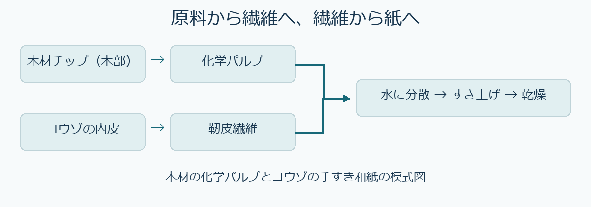

# 番外編　紙・パルプ・和紙

第3回の細胞壁、第4回の木材成分、第12回の資源循環を復習し、同じセルロース系の材料でも、原料・工程・繊維の組み方で用途が変わることを説明します。読解と自己確認の目安は15～20分です。

## 繊維を取り出し、紙にする

木材パルプは、木材から取り出した繊維を主とする原料です。**化学パルプ**では、蒸解でリグニンの多くを除き、繊維を分離します。**機械パルプ**では、主に機械的に繊維を分離するので、リグニンは多く残ります。和紙の代表例としてコウゾを使う場合、**樹皮の内側にある靭皮**から繊維を取ります。蒸解や洗浄などで繊維をほぐし、水に分散させてすき、乾かします。原料の違いを押さえると、木材からリグニンを除く化学パルプ化との共通点も見えてきます。

水を除く過程で繊維同士が近づき、接触部に結合が生じてシートになります。繊維の長さ、繊維同士の接触、配向、シートの厚さなどが紙の性質に関わります。「薄い」「丈夫」「水を吸う」などの性質を比較するときは、用途と測り方を先に決めます。

## 紙の繊維とミクロフィブリル

紙に残る植物繊維は、細胞壁をもった構造です。**ミクロフィブリルは、その細胞壁を構成するさらに細かな構造**です。観察では、まずシートの中で繊維がどう重なるかを見て、次に細胞壁の内側の構造へ尺度を移します。森林総合研究所では、スギの化学パルプを原料に、さらに細かくほぐしてセルロースナノファイバーを製造しています。紙のシート形成と、セルロースをナノスケールの材料として取り出す操作を区別します。[森林総合研究所のセルロースナノファイバー製造例](https://www.ffpri.go.jp/news/2015/20150709nanofiber/index.html)

**研究例**　Yonenobu・Tsuchikawa・Satoは、年代の異なる手すき和紙に重水を作用させ、近赤外分光法でOH基の状態に関係する信号の変化を調べました。この研究では、セルロースの配列の秩序が低いと解釈された領域ほど重水が到達しやすく、最も古い試料では浸透の初期に表層の構造が影響したと考察しています。近赤外分光法が示すのは分子の結合状態に関する情報です。シートの繊維構造を電子顕微鏡で観察した結果と組み合わせることで、異なる尺度の情報を照合できます。[Yonenobuほか（2009）原論文](https://doi.org/10.1016/j.vibspec.2008.11.001)

## 地域の技術と、材料としての使い方

| 事例 | 材料として考える問い |
| --- | --- |
| 石州半紙（島根）、本美濃紙（岐阜）、細川紙（埼玉） | 同じコウゾを用いる手すき技術でも、地域ごとの工程や用具にどのような違いがあるか。 |
| 公文書の繕い・裏打ち | 欠損部に当てる紙と裏面全体を支える紙では、薄さ・柔軟さ・強さをどう選ぶか。 |
| スギパルプ由来のセルロースナノファイバー | 繊維をさらに細かくすると、紙をすく場合とどのように用途の考え方が変わるか。 |

[文化庁「和紙：日本の手漉和紙技術」](https://online.bunka.go.jp/special_content/intangible/209803) ／ [国立公文書館の修復事例](https://www.archives.go.jp/naj_news/29/kobuncho.html)

国立公文書館の修復では、破れや欠損に合わせて和紙を当てる「繕い」と、裏面を和紙で支える「裏打ち」を使い分けています。薄い機械すき和紙で表裏から補強する例もあります。紙の薄さと補強する範囲を、資料を保存するための設計条件として考えられます。[国立公文書館の修復工程](https://www.archives.go.jp/naj_news/29/kobuncho.html)

## 古紙を資源として使う

古紙は選別・離解し、製品に応じて異物やインキを除いて再利用します。循環のしやすさは、紙の種類、汚れや異物、回収方法、次の製品に必要な品質によって変わります。第12回で扱った「再利用先が求める条件」に当てはめて考えます。

## 自己確認

1. 木材の化学パルプとコウゾを使った和紙について、繊維を取る部位と共通する工程を説明してください。
2. 紙を拡大して見える繊維と、ミクロフィブリルの関係を一文で説明してください。
3. 古い文書の破れを繕う紙を選ぶとき、厚さ以外に何を確認しますか。原資料と補修紙を組み合わせる観点から考えてください。

解答例

1. 木材の化学パルプは木部、コウゾ和紙は内皮の靭皮から繊維を得る。分離した繊維を水に分散させ、すき上げ、乾かしてシートにする工程が共通する。
2. ミクロフィブリルは、紙に残った植物繊維の細胞壁を構成する、より細かな構造である。
3. 原紙と補修紙の曲げやすさ、濡れたときと乾いた後の寸法変化、接着に使う材料との相性などを確認する。補修する範囲によっても求める性質は変わる。

教科書参照　日本木材学会編『木材学 基礎編』第8章「紙・セルロースナノファイバー」、pp.209以降。

[第3回 超微細構造](../第03回/学習ガイド.md) ／ [第4回 主要構成成分](../第04回/学習ガイド.md) ／ [第12回 集成材・CLTと木材資源の利用](../第12回/学習ガイド.md) ／ [教材一覧](../README.md)
