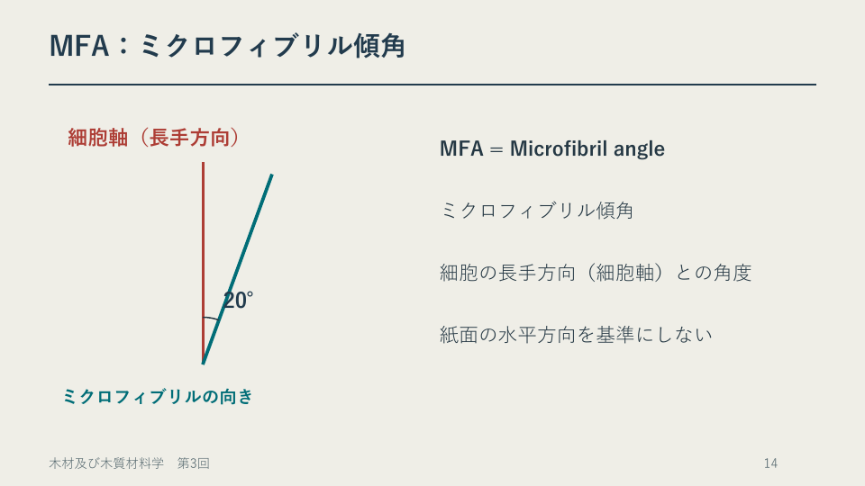

# 第3章　超微細構造

学習ガイド更新日：2026年11月6日。スライドは章・節版、時刻は節の見通し付き動画に対応します。ガイドのページ番号は本編 p. の番号です。PDFビューアーの通し枚数と異なる場合は、しおりまたは節の導入位置を目印にしてください。

## この章の各節

学習ガイドを開き、視聴する節の「扱う話題」と「結論の見通し」を先に読んでください。ページ番号と開始時刻を目印に、スライドや動画へ進みます。

### 3.1　細胞壁を尺度ごとに見る

**視聴の目印**　本編 p.1～13 ／ PDFの導入は1枚目 ／ 動画 00:00から

**扱う話題**　細胞壁の層、セルロース、ミクロフィブリル、倍率。

**結論の見通し**　木片、細胞、細胞壁を別の尺度として捉え、観察図ではスケールバーを基準に大きさを求める。

### 3.2　ミクロフィブリル傾角と剛性

**視聴の目印**　本編 p.14～19 ／ PDFの導入は15枚目 ／ 動画 38:31から

**扱う話題**　MFAの基準線、10°と40°、ヤング率、スギの研究例。

**結論の見通し**　細胞軸を基準にMFAを読み、配向が変形しにくさに関わることを他の条件と区別して説明する。

**Key graphic（PDF 14ページ）**　ミクロフィブリル傾角は細胞軸とミクロフィブリルのなす角。例の角度は20°。

### 3.3　目切れとミクロな配向

**視聴の目印**　本編 p.20～30 ／ PDFの導入は22枚目 ／ 動画 57:32から

**扱う話題**　部材軸と繊維方向、細胞軸とミクロフィブリル、伸びの計算。

**結論の見通し**　目切れとMFAでは角度を測る基準線が異なる。材の伸びを比べるときはE・断面積・荷重の条件も示す。

## この回の進め方と時間の目安

動画の再生時間は **91:45** です。画面表示付きの演習・休憩 **04:20** は再生時間に含まれます。視聴中はその時間を使い、足りないときは一時停止します。準備と自己確認を含めて **約97～99分** を見込みます（1倍速での計画例。追加の一時停止・任意の深掘り・正式課題は別）。

1. **準備（約2分）** [この回の教材](README.md)でPDFと動画を開き、下の自己確認の問いを一度読んでおきます。
2. **前半（00:00～49:33）** 細胞壁の層とミクロフィブリルの向きを図で読む。
3. **後半（49:33～91:45）** 配向、目切れ、変形の関係を区別する。分けて視聴する場合は、後半の開始時刻から再開できます。
4. **自己確認（別に約3～5分・提出不要）** PDF21頁（61:16）の活動を見直します。二つの角度について、どの線から測るかを図に書き込む。解説やガイドで確かめ、迷った点を一つ残します。

[動画の目次とPDFページ](動画の目次.md)で戻る箇所を確認できます。ほかの例題や参考資料は復習・深掘りにも使えます。受講範囲と提出物はTeamsの案内に従ってください。

各節の冒頭に、扱う話題と結論の見通しを示す画面があります。音声・字幕・目次はこの動画の時刻に対応します。

30ページ、動画91:45。[動画と教材](README.md) ／ [時刻とPDFページ](動画の目次.md)。画面右下の番号とPDFのページ順をそろえました。

前回の「壁の量」に、今回の「壁の層と内部の向き」を加えます。問いと復習は自己確認用です。受講時期と正式課題はTeamsで確認してください。

## オンデマンド回の質問・意見交換と振り返り

- **自己確認と解説**　上の自己確認に取り組み、動画またはガイドの解説で確かめます。根拠や条件があいまいだった箇所を一つ残してください。
- **Teamsで質問・意見交換**　本科目専用チームの該当回の案内から、下の問いについて自分の考えと根拠を短く書く、または他の人の考えに理由や質問を添えて返信できます。個別の相談はTeamsで担当教員へ連絡してください。
- **この回の意見交換の問い**　ミクロフィブリル傾角を説明する図では、どの線を基準にしますか。互いの図の基準線を比べ、初めて見る人に伝わる表し方を考えましょう。
- **教員からの指導**　担当教員は、各回の受講期間終了後速やかに、質問への回答や、考え方・誤解しやすい点の補足をTeamsで行います。補足と回答は該当回の案内から確認してください。
- **進み具合の確認**　教員は毎週の受講確認票に加え、該当回の質問・意見交換で見えた理解やつまずきを確認し、必要な補足に使います。受講確認票は毎週木曜13時までに提出します。

意見交換は、A1～A4とは別の学習活動です。 [受講方法](../受講方法.md) ／ [受講確認票](../受講確認/README.md)

## 1　細胞と、その壁の内部を区別する

前回は壁の体積割合と密度を考えました。今回は、壁内部の層と配向を加えます。木材全体の繊維方向、細胞の長手方向、細胞壁内部のミクロフィブリルの向きは、尺度を分けて説明します。

| 対象 | 読む情報 |
| --- | --- |
| 木材 | 年輪・節・繊維の流れと、部材に対する繊維方向 |
| 細胞 | 壁と内腔、細胞の形や配列 |
| 細胞壁内部 | 層構造と、ミクロフィブリルの主な配向 |

## 2　隣り合う細胞と層の順序

左の内腔から右の内腔へたどる順：内腔 → S3 → S2 → S1 → P → ML→ P → S1 → S2 → S3 → 内腔。これは層の関係を表す模式的な並びです。

| 記号 | 対応する構造 |
| --- | --- |
| ML | 細胞間層（middle lamella）。隣り合う細胞を結ぶ領域。 |
| P | 一次壁。S1とは別の区分。 |
| S1・S2・S3 | 二次壁の三つの層。一次壁側から内腔側へS1、S2、S3の順に並ぶ。典型的にはS2が二次壁の厚さの大きな部分を占める。 |
| 複合細胞間層 | 一次壁P＋細胞間層ML＋隣の一次壁Pを含む範囲。細胞間層だけとは範囲が異なる。 |

## 3　ミクロフィブリルとMFA

セルロース分子の鎖が集合した細長い構造がミクロフィブリルです。細胞壁の内部にあり、細胞一本や肉眼で見える木目とは尺度が異なります。壁にはヘミセルロースやリグニンも組み合わさっています。

MFA = Microfibril angle（ミクロフィブリル傾角）。以下でL方向のヤング率と比較する際は、主にS2層のMFAを扱います。細胞の長手方向（細胞軸）と、ミクロフィブリルの主な向きとの角度です。紙面の水平方向を固定した基準にはしません。図を回転しても、二つの向きの間の角は変わりません。

一次壁Pでは多方向の配向。二次壁の典型例では、S1・S3は細胞軸への傾角が比較的大きく、厚いS2は細胞軸に比較的近い配向です。らせん状の配向と、その壁を広げた平面図を対応させます。透視図の見かけの角を分度器で測り、実際のMFAとして扱うことはできません。

借用図：USDA Wood Handbook 2021, Chapter 3, Fig. 3–6（冊子3–7頁、PDF7頁）。層構造の説明は3–8頁。https://research.fs.usda.gov/treesearch/62242 。色付きの隣接細胞図と角度図は説明用模式図。図の色・厚さ比は測定値ではありません。

---

## 4　演習1：倍率と単位換算

設定：実物の壁厚2 μmを、紙上で20 mmに描きます。画面上の図を定規で測るのではなく、次の設定値で計算します。

① 図の倍率を求める。
② 実物で5 μm離れた二点は、同じ図で何mm離れるか。
③ 図で8 mmの層は、実物では何μmの厚さか。

| 問い | 計算と答え |
| --- | --- |
| ① | 20 mm = 20,000 μm。倍率 = 20,000 / 2 = 10,000倍。 |
| ② | 5 μm × 10,000 = 50,000 μm = 50 mm。 |
| ③ | 8 mm / 10,000 = 0.0008 mm = 0.8 μm。 |

1 mm = 1,000 μm、1 μm = 1,000 nm。長さの倍率は、同じ単位にそろえた「図の長さ/実物の長さ」です。倍率自体には単位が付きません。

## スケールバーで確かめる例

実物10 μmを表すバーが紙面で20 mm、対象が紙面で6 mmなら、実物寸法は10 μm × (6/20) = 3 μm。写真を2倍に拡大し、バーが40 mm・対象が12 mmになっても、比12/40は同じです。画像とバーを一緒に、縦横比を保って拡大します。

## 5　配向と変形しにくさ

他の条件がそろえば、S2のMFAが小さい材ほど、一般にL方向のヤング率Eが高い傾向があります。角度だけからEや破壊荷重の数値を決める式ではありません。樹種、形成部位、密度、含水状態、試験方向・方法なども確認します。

針葉樹の未成熟材ではS2のMFAが大きい場合が多く、形成された部位も材質の手掛かりになります。あて材の構造は、針葉樹の圧縮あて材と広葉樹の引張あて材で異なり、全てに同じMFAの変化を当てはめません。

## 6　目切れとMFAを図で区別する

| 比較 | 基準になる二つの向き |
| --- | --- |
| 目切れ | 部材の長手方向と、内部の主な繊維方向。繊維が部材の側面で途切れる状態を図で示す。 |
| MFA | 細胞の長手方向と、細胞壁内部のミクロフィブリルの主な向き。尺度が異なる。 |

目切れのない板でも、細胞の壁内部には配向があります。二つの角度は、一方があれば他方がなくなる関係ではありません。

---

## 7　演習2：基準線を使った説明

① 細胞軸を縦に描き、MFA10°と40°の二例を作図する。
② 樹種・密度・水分等をそろえると、どちらがL方向へ変形しにくいと予想するか。理由も書く。
③ 10°の図を90°回転し、細胞軸が横向きでも同じMFAを示す。
④ 目切れとMFAについて、それぞれ基準となる二つの向きを書く。

## 演習2の確認

① 細胞軸から測る。10°の方が軸に近い配向。
② 小さいMFAの例で、一般にL方向のEが高く、同じ応力に対してひずみが小さい傾向を予想する。角度の比から伸びの倍率は決めない。
③ 図を回しても二つの向きの間は10°。紙の縦横から取り直さない。
④ 目切れは部材軸と繊維方向、MFAは細胞軸と壁内部の配向。

## 8　フックの法則と計算例

16ページでは、ばねF=kxと、一様な棒の軸方向引張りを対応させます。応力σ=F/A、ひずみε=Δl/l。小変形・線形弾性の範囲でσ=Eεです。

F/A=E(Δl/l)から、F=(EA/l)Δl。棒全体のばね定数はk=EA/l、伸びはΔl=Fl/(EA)となります。Eは指定方向・含水状態の材料特性、kは寸法も含む棒全体の伸びにくさです。EをMPa、Aをmm²、lをmmで使えば、kの単位はN/mmになります。1 MPa=1 N/mm²です。

23ページは、元の長さl=100 mmを共通にした架空例です。

| 例 | A / mm² | F / N | σ / MPa | E / MPa | ε（無次元） | Δl / mm |
|---|---|---|---|---|---|---|
| A | 10 | 60 | 6 | 6000 | 0.001 | 0.100 |
| B | 10 | 60 | 6 | 12000 | 0.0005 | 0.050 |
| C | 20 | 60 | 3 | 6000 | 0.0005 | 0.050 |

計算はσ=F/A、ε=σ/E、Δl=εlの順です。0.001=1/1000=0.1％、0.0005=1/2000=0.05％。ひずみの小数と百分率を区別します。

- AとB：同じ応力と長さで、Eを2倍にすると伸びは半分。
- AとC：同じ力・E・長さで、断面積を2倍にすると応力と伸びは半分。

BとCの伸びは同じでも、変えた条件が異なります。Eは説明用の設定値で、MFA10°・40°から算出した値ではありません。MFAの比をEや伸びの比に直接置き換えず、変形しにくさと破壊強度も区別します。

## 9　中学校での説明と復習

ストロー束は細胞の配列と内腔を示す模型。壁内部には別の拡大図を添え、模型のどの部分が実物の何に対応するかを明示します。細胞壁の層名やMFAを、中学生の必須暗記項目へ一律に加えることは目的にしません。繊維方向による性質・加工の違いを説明する教員の背景知識として使います。

復習：木材・細胞・細胞壁を尺度付きで1枚に図示し、S2の位置、MFAの基準線、目切れとの違いを説明します。自己確認用です。既存課題A1は第4回後、A2は第6回後、A3は第10回後、A4は第13回後。提出方法と締切は授業の案内に従ってください。

## 参考資料とリンク

USDA Wood Handbook 2021, Chapter 3（図と層構造）：https://research.fs.usda.gov/treesearch/62242
宮下智弘ほか（2021）日本森林学会誌103(2),71–77：スギのMFAと根元曲がり。https://doi.org/10.4005/jjfs.103.71

中学校学習指導要領（平成29年告示）解説 技術・家庭編、A(1)ア、冊子25～26頁。https://www.mext.go.jp/component/a_menu/education/micro_detail/__icsFiles/afieldfile/2019/03/18/1387018_009.pdf

東京書籍 R7年間指導計画：https://ten.tokyo-shoseki.co.jp/text/chu/gijutsu/download/documents/R7gijutsu_keikaku.pdf 。公開計画と、実際の採択教科書の本文・頁は区別して照合します。公開計画で確認した範囲を、教科書本文を確認した範囲へ広げて表現しません。

## 研究例を読む：19ページ

[宮下ほか（2021）の公開本文](https://www.jstage.jst.go.jp/article/jjfs/103/2/103_71/_pdf/-char/ja)の測定方法（冊子73頁）と、MFAの群間比較（74頁・図1）を確認しました。

- 抵抗性6系統、対照6系統、計12系統38個体から胸高部コアを採取。「6系統」は「6個体」と同じ意味ではありません。
- 晩材仮道管の壁孔孔口が仮道管長軸となす角を、MFAの指標として使用。対象年輪ごとに50本の仮道管を測り、平均を求めています。
- 測定対象年輪のMFAは抵抗性群で小さく、第3・第5年輪では群間の有意差を報告しています。
- 幼齢期の樹幹Eが高かったという説明は、MFAとEの一般的な関係を用いた考察です。この研究でEを直接測定した結果として置き換えません。

ここでは測定対象・方法と、実測結果／推測を区別して読みます。統計解析全体を再現したという意味ではありません。根元曲がりの評価には既往の調査値も用いられており、38個体の現在のMFAから、その個体の幼齢時の曲げEを直接測り直した研究ではありません。

## ページ対応

| PDFページ | 内容 |
|---|---|
| 3～8 | 壁と内腔、層構造、尺度、各層の配向 |
| 10・11 | らせんの模式図と尺度の対応 |
| 12・13 | 倍率と単位換算の演習・解説 |
| 14・15 | MFAの定義と角度の比較 |
| 16・18・19 | 線形弾性、形成部位、研究例 |
| 20～22 | 目切れとMFA、作図演習と解説 |
| 23 | 同じ応力でのひずみと伸びの計算 |
| 24・26～28 | 模型、自己確認、整理と復習 |

二次木部は形成層からできる組織を指し、二次壁は一つの細胞壁内の区分です。「二次」という語が共通でも、同じ構造ではありません。第2回の壁体積率から密度を求めるモデルに、今回は壁内部の層・配向を加えて考えます。

## 共通の確認

科目コードは05242020です。正式課題は専用Wordフォームで作成し、科目コード_課題コード_学籍番号.pdfとしてTeamsへ提出します。[課題と評価基準](../課題/README.md)を確認してください。動画内の自己確認は追加の提出課題ではありません。

## 自己確認の見直し方

| 内容 | 自分で確かめること |
|---|---|
| 層構造（3～8ページ） | 内腔からS3・S2・S1・P・MLをたどれるか。一次壁Pと二次壁S1、細胞間層と複合細胞間層を区別したか |
| 倍率（12・13ページ） | 同じ単位の長さを割ったか。図から実物へ戻す場合と、実物から図へ拡大する場合を区別したか |
| MFAの作図（21・22ページ） | 細胞軸と壁内部の配向、角の印が対応するか。図を回しても10°が変わらないか |
| 伸び（23ページ） | Eを変えたA/Bと、断面積を変えたA/Cで、条件と理由を分けたか |
| 研究例（19ページ） | 研究対象・測定した角度・比較結果と、Eについての考察を分けたか |

これらは自主学修用です。正式課題の配点・評価基準は[課題の案内](../課題/README.md)を使用します。

[番外編「紙・パルプ・和紙」](../番外編/紙・パルプ・和紙.md)
