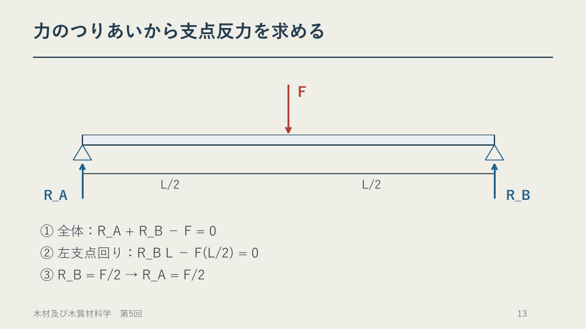
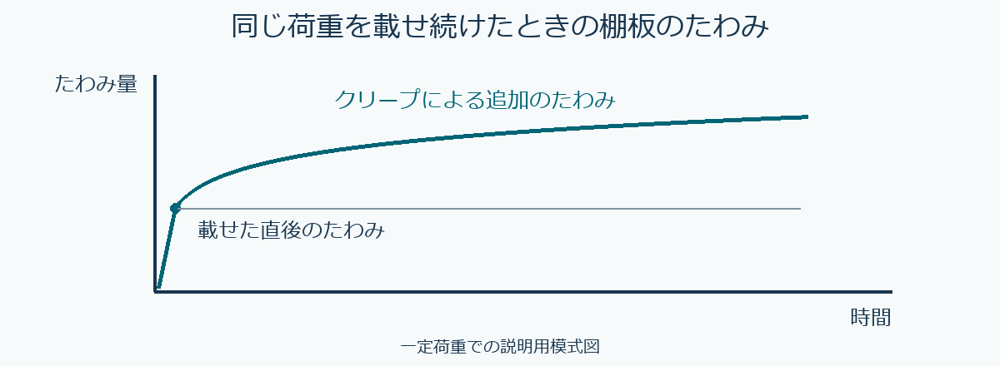

# 第5章　強度と物性値

学習ガイド更新日：2026年11月6日。スライドは章・節版、時刻は節の見通し付き動画に対応します。ガイドのページ番号は本編 p. の番号です。PDFビューアーの通し枚数と異なる場合は、しおりまたは節の導入位置を目印にしてください。

## この章の各節

学習ガイドを開き、視聴する節の「扱う話題」と「結論の見通し」を先に読んでください。ページ番号と開始時刻を目印に、スライドや動画へ進みます。

### 5.1　力・応力・物性値

**視聴の目印**　本編 p.1～11 ／ PDFの導入は1枚目 ／ 動画 00:00から

**扱う話題**　ばねと棒、kg・kgf・N、Pa・MPa、Eと強度。

**結論の見通し**　質量から力、力から面積当たりの応力へ進み、変形しにくさを表すEと破壊に関わる強さを区別する。

### 5.2　つりあいから梁の計算へ

**視聴の目印**　本編 p.12～22 ／ PDFの導入は13枚目 ／ 動画 27:54から

**扱う話題**　支点反力、モーメント、A・I・Z、物性表、中央たわみ。

**結論の見通し**　荷重と支点を図にして反力を求め、断面と物性値を用いて最大応力とたわみを別々に計算する。

**Key graphic（PDF 13ページ）**　中央に下向きの荷重F、両支点に上向きの反力。力と左支点回りのモーメントのつりあいから反力は各F/2。

### 5.3　何をそろえて比較するか

**視聴の目印**　本編 p.23～35 ／ PDFの導入は25枚目 ／ 動画 57:15から

**扱う話題**　同じ荷重と同じたわみ、支点間距離、断面高さ、測定計画。

**結論の見通し**　固定する量によって比較の答えが変わる。実測では寸法・水分・荷重条件をそろえ、結論の範囲を示す。

## この回の進め方と時間の目安

動画の再生時間は **92:02** です。画面表示付きの演習・休憩 **25:14** は再生時間に含まれます。視聴中はその時間を使い、足りないときは一時停止します。準備と自己確認を含めて **約97～99分** を見込みます（1倍速での計画例。追加の一時停止・任意の深掘り・正式課題は別）。

1. **準備（約2分）** [この回の教材](README.md)でPDFと動画を開き、下の自己確認の問いを一度読んでおきます。
2. **前半（00:00～51:28）** 力の単位と梁のつりあいを復習し、物性表で比較条件を確認する。
3. **後半（51:28～92:02）** 応力とたわみの解説を見て、支点間距離・高さの効果を比べる。分けて視聴する場合は、後半の開始時刻から再開できます。
4. **自己確認（別に約3～5分・提出不要）** PDF19頁（47:00）の活動を見直します。2樹種の最大応力と中央たわみを比較し、どちらが同じか説明する。解説やガイドで確かめ、迷った点を一つ残します。

[動画の目次とPDFページ](動画の目次.md)で戻る箇所を確認できます。ほかの例題や参考資料は復習・深掘りにも使えます。受講範囲と提出物はTeamsの案内に従ってください。

各節の冒頭に、扱う話題と結論の見通しを示す画面があります。音声・字幕・目次はこの動画の時刻に対応します。

新版スライドのPDFページ順で参照します。スライド・動画は11月6日の章・節対応版です。動画は92:02。[動画と教材一覧](README.md)／[時刻とPDFページ](動画の目次.md)。

**今回の改訂点：** PDF3～15頁のモデル条件とE・強度の区別を明確化。17頁の物性表は単位・出典・試験条件とともに読む。

2026年11月4日。全35ページの新版スライドに対応します。受講する回・時期はTeamsの案内に従ってください。

必要に応じて一時停止し、図・途中式・単位・比較条件を残してください。演習は自己確認用です。正式な提出課題A2の作業時間は動画90分と別です。ページ番号はPDFの通し頁で、今回の画面番号と一致します。

| 量 | 意味・式 | 単位 |
|---|---|---|
| 質量m／力F | F=mg。kgとkgfを区別する | kg／N |
| 応力σ／ひずみε | 軸方向：σ=F/A、ε=Δl/l | MPa／無次元 |
| ヤング率E | 線形弾性の範囲でE=σ/ε。破壊強度とは別 | MPa |
| 棒のばね定数k | F=kΔl、k=EA/l（軸方向の棒） | N/mm |
| 断面のA・I・Z | A=bh、I=bh³/12、Z=bh²/6 | mm²・mm⁴・mm³ |

## オンデマンド回の質問・意見交換と振り返り

- **自己確認と解説**　上の自己確認に取り組み、動画またはガイドの解説で確かめます。根拠や条件があいまいだった箇所を一つ残してください。
- **Teamsで質問・意見交換**　本科目専用チームの該当回の案内から、下の問いについて自分の考えと根拠を短く書く、または他の人の考えに理由や質問を添えて返信できます。個別の相談はTeamsで担当教員へ連絡してください。
- **この回の意見交換の問い**　同じ寸法・支持・荷重の梁で樹種だけを変えると、最大応力と中央たわみのどちらが変わりますか。比較条件と根拠を示しましょう。
- **教員からの指導**　担当教員は、各回の受講期間終了後速やかに、質問への回答や、考え方・誤解しやすい点の補足をTeamsで行います。補足と回答は該当回の案内から確認してください。
- **進み具合の確認**　教員は毎週の受講確認票に加え、該当回の質問・意見交換で見えた理解やつまずきを確認し、必要な補足に使います。受講確認票は毎週木曜13時までに提出します。

意見交換は、A1～A4とは別の学習活動です。 [受講方法](../受講方法.md) ／ [受講確認票](../受講確認/README.md)

## kg → kgf・N → Pa・MPa

kgは質量、kgfとNは力。1 kgf＝9.80665 N。1 Pa＝1 N/m²、1 kgf/m²＝9.80665 Pa。1 m²＝10⁶ mm²なので、1 N/mm²＝10⁶ Pa＝1 MPa。演習でg=9.80 m/s²と丸めた場合は、その条件を明記します。

質量2.00 kg、g=9.80 m/s²、面積200 mm²なら、F=19.60 N、F/A=0.0980 MPa=98,000 Pa。均一に接触する説明用モデルです。

## 剛性・強度・硬さ

剛性は部材の変形しにくさで、Eに加え形状・長さ・支持等が関わります。強度は荷重や破壊の種類を指定した指標。硬さは押込みなどへの抵抗です。「丈夫」という言葉を、測る量と条件へ言い換えます。

## 実際の物性値と、曲げの計算

| USDA Wood Handbook 2021 Table 5–3a | 曲げE / MPa | MOR / MPa |
|---|---|---|
| Douglas-fir（Coast） | 13,400 | 85.0 |
| Sitka spruce | 10,800 | 70.0 |

含水率12％、無欠点小試験片、静的曲げの代表値。原表MORは85,000／70,000 kPaで、1,000で割ってMPaへ換算。曲げE列は元からMPa。該当箇所は本の5–7頁／5–8頁。設計用許容応力度ではありません。

## 力とモーメントから順に考える

中央集中荷重・左右単純支持、一定断面、曲げ主体、小変形・線形弾性のモデル。上向きを正とすればR_A+R_B−F=0。左支点回り：R_B L−F(L/2)=0 → R_A=R_B=F/2。中央M最大=(F/2)(L/2)=FL/4。σ最大=M最大/Z、δ中央=FL³/(48EI)。Lは板全長ではなく支点間距離。δは中央の鉛直たわみです。bは断面幅、hは荷重方向の断面高さで、IとZは図の中立軸について計算します。自重による追加たわみは今回の計算に含めません。

曲げEを用いた計算は教育用の近似です。原表の曲げEにはせん断たわみの影響が含まれると説明されています（原典5–2頁）。ここでは表の値をそのまま使い、曲げ主体の梁モデルで比較します。軸方向のEへの置換や、せん断たわみの別途加算は行いません。短く厚い部材等への適用は別途検討が必要です。

F=100 N、L=600 mm、b=80 mm、h=15 mm。I=22,500 mm⁴、Z=3,000 mm³、M最大=15,000 N·mm。σ最大=5.00 MPa（両材料で同じ）。δはDouglas-fir約1.49 mm、Sitka spruce約1.85 mm。

| 変更条件（その他は固定） | 応力の比 | たわみの比 |
|---|---|---|
| 支点間600→720 mm | 1.2 | 1.2³=1.728 |
| 高さ15→18 mm（幅一定） | 1/1.2² | 1/1.2³ |

高さ18 mmでは、σ約3.47 MPa、δ約0.864／1.07 mm。短期の代表値による計算だけで、節・繊維傾斜・水分変動・クリープ・接合等を含む実物の安全を断定しません。

## 自己確認：定義・条件・式を使う

① 仮想試験（一様な棒の軸方向・線形弾性）：l=1,000 mm、A=100 mm²。F=500 NでΔl=0.5 mm、F=1,000 NでΔl=1.0 mm。k、各点のσとε、Eを求める。E・Aを同じとし、元の長さlを2倍にした場合、同じFでの伸びは？

② 原表のMORの単位をMPaへ換算し、樹種・含水率・試料・試験方法・出典箇所を含む比較表を作る。同じ含水率なら、水の質量も同じか？

③ 同じ形・支持で、線形弾性の範囲内でEだけ2倍。Fを固定した場合のδとσ、δを固定した場合のFとσを、それぞれ求める。文字式をFについて解いて説明する。

④ 例題の高さ15 mmを基準とし、14 mm／16 mmの場合のたわみ比を求める。材質の比較で寸法を確認する理由を書く。

⑤ 材料2種の中央たわみを比べる紙上の実験計画を作る。事前に記録する条件を6つ以上、測定の基準位置と繰り返し方を書く。「たわみが小さい＝全用途で強い」という説明を修正する。

## 途中式の点検

面積にはmm²、Zにはmm³、Iにはmm⁴。M/ZはN/mm²、たわみ式はmmが残るか確認。比を取るときは何を一定にしたかを書き、大小の予想と電卓の答えを照合します。

## 中学校の学習との接点

材料の特性と丈夫な部材、条件をそろえた比較。教師はE・強度・試験条件を背景として理解し、生徒には観察・測定・説明が対応する問いを用意します。公開教科書見本と、今後照合する採用教科書の本文を区別します。

## 自己確認の解説と参照資料

① k=1,000 N/mm。σ=5／10 MPa、ε=0.0005／0.001、E=10,000 MPa。長さ2倍ならkは1/2、同じ1,000 NでΔl=2 mm。数値は仮想データです。

② MOR=85.0／70.0 MPa。原表の行・単位・注を確認。同じMCでも全乾質量が違えば水のグラム数は違います。③ F一定：δは1/2、σは同じ。δ一定：Fとσは2倍。どちらも線形弾性の範囲を保つモデルです。

④ (15/14)³≈1.23、(15/16)³≈0.824。寸法差が材質差と重なるので、断面を確認。⑤ 樹種、方向、水分、b・h、支点間、荷重位置、支持、節等を記録。複数試料と繰り返しを区別し、測った条件のたわみについて述べます。

確認問題：1 MPa=1 N/mm²。同じEでもI・L・支持等が違えばたわみは違う。平均的な曲げ強さをそのまま許容応力度にしない。第6回後の提出課題は既存A2です。専用Wordフォームに入力し、PDFとしてTeamsへ提出します。回答ID・式・単位・根拠を残し、[現行の課題案内](https://github.com/zooc-14calbp/wood-science-course/blob/main/課題/README.md)で提出名・評価基準を確認してください。正式な期限等はTeamsの案内に従います。

USDA Wood Handbook 2021 Chapter 5（定義：5–2～5–3頁、Table 5–1：5–2頁、Table 5–3a：5–7／5–8頁）
https://research.fs.usda.gov/treesearch/62244

教育図書R7公開内容解説資料 PDF8頁に教科書28～29頁等の掲載見本。公開見本で照合した範囲と採用教科書全文は区別する。
https://www.kyoiku-tosho.co.jp/wp/wp-content/uploads/2024/04/G_R7kaisetu.pdf

中学校学習指導要領（平成29年告示）解説 技術・家庭編 A 材料と加工の技術
https://www.mext.go.jp/component/a_menu/education/micro_detail/__icsFiles/afieldfile/2019/03/18/1387018_009.pdf

## 演習の進め方と記録

各問いの答えを手元に残してから解説を確認し、違いがあれば式・単位・固定条件のどこが違うかを書き添えます。

| PDF頁 | 演習と記録 |
|---|---|
| 5 | 軸方向の棒：各点のF/Δl、F/A、Δl/l、σ/ε。長さ2倍の場合はE・A・Fを固定したことも記す |
| 7 | 重り：F=mgから圧力へ。mm²とm²の換算を残す。面内一様に荷重が伝わるモデルとして計算 |
| 17～18 | 原表：樹種、12%の行、曲げEとMOR、原単位、換算後単位、出典頁を表へ転記 |
| 19～22 | 曲げ：支点と中央荷重の図、b・h・L、I・Z・M、最大応力、各樹種の中央たわみを記録 |
| 23 | Eだけ2倍：荷重固定とたわみ固定を別々に計算し、何を一定にしたか書く |
| 25～27 | 支点間距離または高さだけ変更：基準に対する比を先に予想し、応力とたわみの倍率を区別 |
| 28・30 | 比較計画：条件6つ以上、荷重前の中央位置、同じ試料での繰り返しと別試料の区別、結論の範囲を記録 |
| 31～33 | 定義の確認と高さ18 mmでの再計算。倍率と数値を照合 |

実測を計画する場合は、中央位置の荷重前後の差としてたわみを読み、支持台の動きや測定位置のずれも確認します。水分状態・節・繊維傾斜などを記録し、高さ以外の違いが残る点を考察します。同じ試料の繰り返しを独立した複数試料として数えません。

## 第4回とのつながり

同じ含水率12%でも、全乾質量100 gなら水12 g、全乾質量200 gなら水24 gです。割合が同じことと、水のグラム数が同じことは区別します。表の12%は木材で通常用いる全乾質量を分母とする含水率です。

## 曲げ強さMORと計算応力

この演習の5.00 MPaは、与えた100 Nの荷重による最大曲げ応力の計算値です。表の85.0／70.0 MPaは破壊試験の最大荷重から弾性の曲げ式で算出するMORです。破壊直前の局所応力分布をそのまま実測した値ではなく、設計用許容応力度でもありません（原典5–3頁）。この区別を保ち、5.00 MPaとの単純な比だけで実物の安全を判断しません。

## ページの目安

3～10頁：軸方向の式・単位・Eと強度の区別。12～18頁：梁、断面、出典の物性表。19～27頁：曲げと寸法変更。28～33頁：授業案と記録・復習。34～35頁：まとめと参考資料。11・20・29頁は休憩です。

## 共通の確認

科目コードは05242020です。正式課題は専用Wordフォームで作成し、科目コード_課題コード_学籍番号.pdfとしてTeamsへ提出します。[課題と評価基準](../課題/README.md)を確認してください。動画内の自己確認は追加の提出課題ではありません。

## 棚板のたわみは時間とともにどう変わるか

荷物を載せると棚板はすぐにたわみます。その後、同じ荷重をかけ続けても、たわみが時間とともに増えることがあります。この時間依存の変形をクリープと呼びます。第5回の梁の式で求めるたわみは、ここでは載荷直後の比較に使います。

温度や水分の条件でもクリープの大きさは変わります。特に荷重をかけたまま吸放湿を繰り返すと、変形が増えやすくなる場合があります。実物を比べるときは、荷重と支点間距離、測定時刻、温湿度を記録します。

**確認**　同じ棚板に同じ荷物を載せたまま、直後と一週間後のたわみを比べるとき、どんな条件をそろえ、何を記録しますか。

**解答例**　荷物の量・位置と支点間距離をそろえ、同じ位置で同じ基準から測ります。載荷前の状態、載荷直後と一週間後の値、室内の温湿度を記録します。図から一週間後のたわみ量を数値で求めることはできません。

[USDA Forest Products Laboratory『Wood Handbook』第5章（荷重継続時間とクリープ）](https://research.fs.usda.gov/treesearch/62244)
