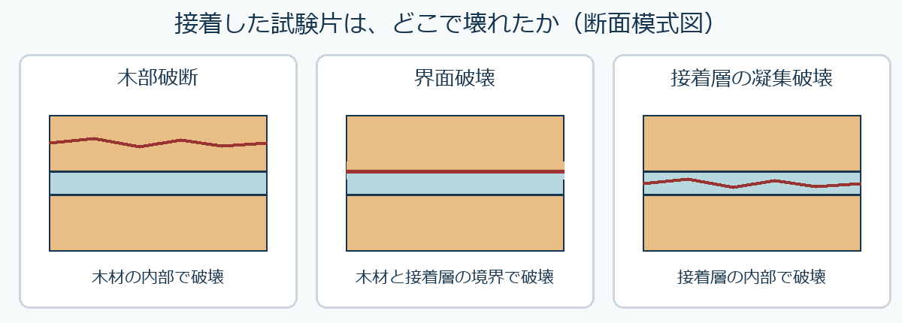

# 第11章　接着・塗装と木質材料の設計

学習ガイド更新日：2026年11月6日。スライドは章・節版、時刻は節の見通し付き動画に対応します。ガイドのページ番号は本編 p. の番号です。PDFビューアーの通し枚数と異なる場合は、しおりまたは節の導入位置を目印にしてください。

## この章の各節

学習ガイドを開き、視聴する節の「扱う話題」と「結論の見通し」を先に読んでください。ページ番号と開始時刻を目印に、スライドや動画へ進みます。

### 11.1　接着層が力を伝えるまで

**視聴の目印**　本編 p.1～34 ／ PDFの導入は1枚目 ／ 動画 00:00から

**扱う話題**　ぬれ、硬化、圧締、接着剤の種類、湿潤後の保持率。

**結論の見通し**　作業可能時間と荷重を掛けられる時点を区別し、湿潤後の強さは保持率と絶対値の両方で比べる。

### 11.2　要素と層の向きで材を選ぶ

**視聴の目印**　本編 p.35～66 ／ PDFの導入は36枚目 ／ 動画 33:13から

**扱う話題**　合板、LVL、PB、MDF、OSB、積層と曲げ剛性。

**結論の見通し**　要素の形、向き、層の位置を読めば、用途ごとに何を比較すべきか説明できる。

**Key graphic（PDF 42ページ）**　合板の隣り合う単板は繊維方向が直交する。

### 11.3　塗装と表面の仕上げ

**視聴の目印**　本編 p.67～85 ／ PDFの導入は69枚目 ／ 動画 62:43から

**扱う話題**　下地、塗装剤、乾燥、塗り重ね、補修。

**結論の見通し**　使用条件から仕上げを選び、下地処理・塗る回数・待ち時間を製品表示に合わせる。

### 11.4　棚の作業計画をまとめる

**視聴の目印**　本編 p.86～95 ／ PDFの導入は89枚目 ／ 動画 82:11から

**扱う話題**　材料、接合、仕上げ、採用条件。

**結論の見通し**　棚に求める性能を出発点に、材料と加工順序を一つの計画にまとめる。

## この回の進め方と時間の目安

動画の再生時間は **89:48** です。長い演習待ち時間はありません。下の自己確認は、指定の場面で一時停止して行います。準備と自己確認を含めて **約97～100分** を見込みます（1倍速での計画例。追加の一時停止・任意の深掘り・正式課題は別）。

1. **準備（約2分）** [この回の教材](README.md)でPDFと動画を開き、下の自己確認の問いを一度読んでおきます。
2. **前半（00:00～53:57）** 接着の原理と工程を理解し、ボード類の構成を比べる。
3. **後半（53:57～89:48）** 積層と剛性、塗装、棚の材料選択を関連付ける。分けて視聴する場合は、後半の開始時刻から再開できます。
4. **視聴中の自己確認（一時停止で約5～8分・提出不要）** PDF33頁（31:42）で一時停止します。解説の前に、乾燥時と湿潤後の荷重からA・Bの保持率を求める。解説やガイドで確かめ、迷った点を一つ残します。

[動画の目次とPDFページ](動画の目次.md)で戻る箇所を確認できます。ほかの例題や参考資料は復習・深掘りにも使えます。受講範囲と提出物はTeamsの案内に従ってください。

接着・塗装と木質材料の設計。95ページ、動画89:48。接着の原理を実際の作業と結びつけ、木質材料の構成・曲げ剛性・仕上げへ進みます。

第11回の教材です。受講時期と課題はTeamsで確認してください。

## オンデマンド回の質問・意見交換と振り返り

- **自己確認と解説**　上の自己確認に取り組み、動画またはガイドの解説で確かめます。根拠や条件があいまいだった箇所を一つ残してください。
- **Teamsで質問・意見交換**　本科目専用チームの該当回の案内から、下の問いについて自分の考えと根拠を短く書く、または他の人の考えに理由や質問を添えて返信できます。個別の相談はTeamsで担当教員へ連絡してください。
- **この回の意見交換の問い**　水がかかる木製品の接着剤を選ぶとき、乾燥時の強さと湿潤後の保持率をどう使いますか。使用条件と施工上の注意を一つずつ挙げて比べましょう。
- **教員からの指導**　担当教員は、各回の受講期間終了後速やかに、質問への回答や、考え方・誤解しやすい点の補足をTeamsで行います。補足と回答は該当回の案内から確認してください。
- **進み具合の確認**　教員は毎週の受講確認票に加え、該当回の質問・意見交換で見えた理解やつまずきを確認し、必要な補足に使います。受講確認票は毎週木曜13時までに提出します。

意見交換は、A1～A4とは別の学習活動です。 [受講方法](../受講方法.md) ／ [受講確認票](../受講確認/README.md)

## 内容と動画の区切り

| PDFページ | 動画の時刻 | 内容 |
|---|---|---|
| 1–2 | 00:00–01:05 | 導入：棚を材料と工程から考える |
| 3–34 | 01:05–33:25 | 接着の原理・接着剤・DIYの工程・接着強さ |
| 35–57 | 33:25–53:57 | 合板・LVL・PB・MDF・OSBの構成と材質 |
| 58–66 | 53:57–62:55 | 層の向き・位置、曲げ剛性、棚のたわみ |
| 67–85 | 62:55–82:22 | 表面仕上げ・塗装の種類・実際の塗り方・補修 |
| 86–91 | 82:22–87:33 | 材料選択と製作工程の統合 |
| 92–95 | 87:33–89:48 | 整理・参照資料 |

動画は一時停止できます。演習に取り組む時間や製品表示を調べる時間は、動画の再生時間とは別です。

## 実作業で参照する資料

[接着・塗装の実践ガイド（8ページPDF）](11_接着・塗装の実践ガイド.pdf) ／ [同じ内容のHTML](11_接着・塗装の実践ガイド.html)

木工ボンド、瞬間接着剤、二液型エポキシの選び方と手順、木材表面の準備、水性ウレタンニスの2回塗りの製品例、乾燥と塗り重ねの違い、失敗の見直し、作業記録をまとめました。製品の適用材料・配合比・待ち時間は製品ごとに異なります。使う製品の最新表示を確認します。

## 計算と自己確認

- 33–34ページ：接着強さと湿潤後の保持率。面積20×25＝500 mm²。Aは6.0→1.2 MPa（20%）、Bは7.0→5.6 MPa（80%）。
- 49–50ページ：密度分布と平均値。表層2 mmずつ900 kg/m³、芯6 mmが500 kg/m³なら平均660 kg/m³。平均だけでは内部構成は決まりません。
- 57ページ：吸水率と厚さ膨張率。100→118 gは18%、10.0→10.8 mmは8%。吸水率18%を、そのまま乾量基準含水率MCw＝18%とはできません。全乾質量と試験前の含水状態も必要です。
- 59–66ページ：同じ層数でも配置によって曲げ剛性が変わります。中央集中荷重、同じFとEIなら、支点間距離を2倍にするとたわみは8倍になります。教材の仮想値を製品の保証値として扱わないでください。
- 86–91ページ：棚や家具側板について、材料・向き・厚さ・接合・仕上げ・使用条件を関連づけて説明します。

これらは授業内の演習・自己確認です。追加の提出課題ではありません。正式課題A1～A4の配信・提出・締切はTeamsを確認してください。提出ファイル名は「05242020_課題コード_学籍番号.pdf」です。

## 接着強さの例題を順に確かめる（PDF33–34ページ）

動画31:42からの例題では、保持率の分母を**湿潤処理前の乾燥状態で測った接着強さ**とします。接着直後や硬化途中の強度を意味しません。実作業で「動かせる時点」と「十分に硬化して荷重をかけられる時点」を区別する話とは分けて読んでください。

1. 接着面積を求める：20 mm × 25 mm ＝ 500 mm²。
2. 接着強さを求める：破壊荷重 ÷ 接着面積。1 N/mm² ＝ 1 MPaです。
3. 保持率を求める：湿潤後の強さ ÷ 乾燥時の強さ × 100。
4. 保持率と、使用に必要な強さの両方を比べます。

| 仮想の接着条件 | 乾燥時の接着強さ | 湿潤後の接着強さ | 保持率 |
|---|---|---|---|
| A | 3000 N ÷ 500 mm² ＝ 6.0 MPa | 600 N ÷ 500 mm² ＝ 1.2 MPa | 1.2 ÷ 6.0 × 100 ＝ 20% |
| B | 3500 N ÷ 500 mm² ＝ 7.0 MPa | 2800 N ÷ 500 mm² ＝ 5.6 MPa | 5.6 ÷ 7.0 × 100 ＝ 80% |

**確認できればよいこと：** この仮想例ではBのほうが湿潤後の強さも保持率も高い。ただし、保持率80%だけでは、その接合部が使用条件を満たすとは判断できません。必要な荷重、接合形状、試験条件なども確かめます。A・Bは市販製品の性能を示すものではありません。

**つまずきやすい点：** 保持率の分母は乾燥時の強さです。「80%保持」は「80%低下」ではなく、この例では20%低下です。Nは荷重、MPaは面積当たりの強さを表します。

## 図版と製品の参照先

[図版・製品の出典](図版・製品の出典.md)に、Wood Handbookの図番号、該当スライド、メーカーの製品情報をまとめました。

[動画・教材の入口](README.md)

## 接着強さと、破壊した場所を一緒に読む

接着の試験では、破壊荷重から求めた接着強さに加え、破壊した場所を観察します。木材の内部で壊れたものが木部破断、木材と接着層の境界で壊れたものが界面破壊、接着層の内部で壊れたものが接着層の凝集破壊です。一つの破面に複数の形態が混在する場合もあります。

木部破断が多いとき、その試験条件では接着部が木材と比べて十分な強さを発揮した可能性があります。湿潤後に木材自体が弱くなっている場合もあるため、破壊荷重、試験時の水分・温度、乾燥時との比較を一緒に確認します。木部破断の割合と、使用に必要な性能を対応させて読みます。

| 観察したこと | 次に見直す条件 |
| --- | --- |
| 接着面の一部に、接着剤がほとんど付いていない | 塗布範囲、表面の汚れ、面の密着、貼り合わせまでの時間 |
| 接着層がまだ軟らかい | 使用温度、経過時間、二液型なら配合と混合の記録 |
| 破面に木材の繊維が多く付く | 木部破断の範囲、破壊荷重、試料差、乾燥・湿潤条件 |

**確認**　同じ形の試験片A・Bが、どちらも木部破断しました。乾燥状態のAの破壊荷重は3,000 N、湿潤後のBは500 Nでした。「木部破断だから同じ性能」と言えますか。次にそろえて比較する条件も挙げてください。

**解答例**　接着面積が同じなら、Bの試験時の接着強さはAの1/6です。木部破断の位置が同じでも、荷重を支える性能の比較には数値が必要です。乾燥・湿潤条件ごとに同じ接着剤と施工条件の試料を用意し、樹種、木理、接着面積、荷重方法、試料数をそろえます。このA・Bは説明用の仮想値です。

### 接着後の塗装へつなぐ

塗装前には、接着剤のはみ出しや汚れ、研磨粉を確認します。はみ出した接着剤が残ると、塗料の浸透や着色が周囲と変わる場合があります。同じ材料の端材で試し塗りし、仕上がりと塗り重ねの間隔を確認してから本材へ進みます。製品表示の「固定できる時間」「荷重をかけられる時間」「塗り重ねできる時間」を作業記録に残します。

[USDA Forest Products Laboratory『Wood Handbook』第10章](https://research.fs.usda.gov/treesearch/62250) ／ [コニシ「接着の基礎知識」塗布・圧締の説明](https://www.bond.co.jp/bond/common/support/pdf/bondbook/bonding_24-25.pdf)

教科書参照　日本木材学会編『木材学 応用編』第15章「接着」、p.123。
