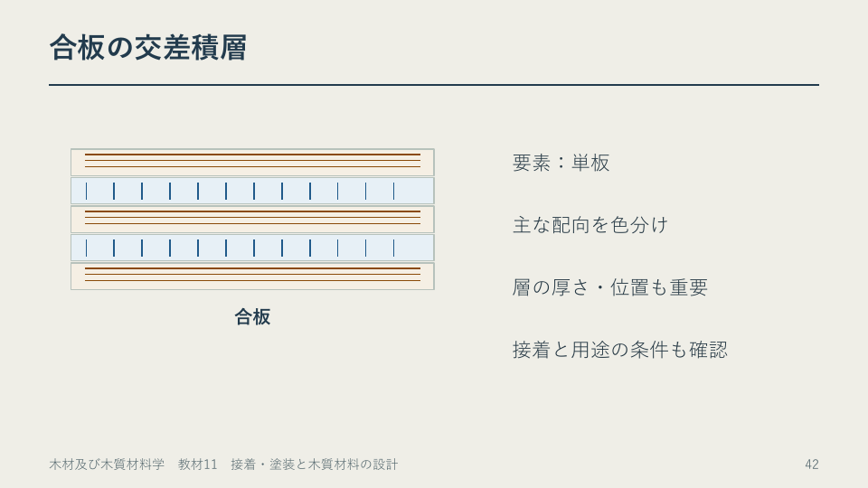

# 第11章　接着・塗装と木質材料の設計

学習ガイド更新日：2026年11月6日。節のページ番号と時刻は、2026年11月4日の視聴配色版に対応します。

## この章の各節

学習ガイドを開き、視聴する節の「扱う話題」と「結論の見通し」を先に読んでください。ページ番号と開始時刻を目印に、スライドや動画へ進みます。

### 11.1　接着層が力を伝えるまで

**視聴の目印**　PDF 1～34ページ ／ 動画 00:00から

**扱う話題**　ぬれ、硬化、圧締、接着剤の種類、湿潤後の保持率。

**結論の見通し**　作業可能時間と荷重を掛けられる時点を区別し、湿潤後の強さは保持率と絶対値の両方で比べる。

### 11.2　要素と層の向きで材を選ぶ

**視聴の目印**　PDF 35～66ページ ／ 動画 32:59から

**扱う話題**　合板、LVL、PB、MDF、OSB、積層と曲げ剛性。

**結論の見通し**　要素の形、向き、層の位置を読めば、用途ごとに何を比較すべきか説明できる。

**Key graphic（PDF 42ページ）**　合板の隣り合う単板は繊維方向が直交する。

### 11.3　塗装と表面の仕上げ

**視聴の目印**　PDF 67～85ページ ／ 動画 62:17から

**扱う話題**　下地、塗装剤、乾燥、塗り重ね、補修。

**結論の見通し**　使用条件から仕上げを選び、下地処理・塗る回数・待ち時間を製品表示に合わせる。

### 11.4　棚の作業計画をまとめる

**視聴の目印**　PDF 86～95ページ ／ 動画 81:33から

**扱う話題**　材料、接合、仕上げ、採用条件。

**結論の見通し**　棚に求める性能を出発点に、材料と加工順序を一つの計画にまとめる。

## この回の進め方と時間の目安

動画の再生時間は **88:59** です。長い演習待ち時間はありません。下の自己確認は、指定の場面で一時停止して行います。準備と自己確認を含めて **約96～99分** を見込みます（1倍速での計画例。追加の一時停止・任意の深掘り・正式課題は別）。

1. **準備（約2分）** [この回の教材](README.md)でPDFと動画を開き、下の自己確認の問いを一度読んでおきます。
2. **前半（00:00～53:31）** 接着の原理と工程を理解し、ボード類の構成を比べる。
3. **後半（53:31～88:59）** 積層と剛性、塗装、棚の材料選択を関連付ける。分けて視聴する場合は、後半の開始時刻から再開できます。
4. **視聴中の自己確認（一時停止で約5～8分・提出不要）** PDF33頁（31:29）で一時停止します。解説の前に、乾燥時と湿潤後の荷重からA・Bの保持率を求める。解説やガイドで確かめ、迷った点を一つ残します。

[動画の目次とPDFページ](動画の目次.md)で戻る箇所を確認できます。ほかの例題や参考資料は復習・深掘りにも使えます。受講範囲と提出物はTeamsの案内に従ってください。

接着・塗装と木質材料の設計。95ページ、動画88分59秒。接着の原理を実際の作業と結びつけ、木質材料の構成・曲げ剛性・仕上げへ進みます。

第11回の教材です。受講時期と課題はTeamsで確認してください。

## 内容と動画の区切り

| PDFページ | 動画の時刻 | 内容 |
|---|---|---|
| 1–2 | 00:00–00:52 | 導入：棚を材料と工程から考える |
| 3–34 | 00:52–32:59 | 接着の原理・接着剤・DIYの工程・接着強さ |
| 35–57 | 32:59–53:31 | 合板・LVL・PB・MDF・OSBの構成と材質 |
| 58–66 | 53:31–62:17 | 層の向き・位置、曲げ剛性、棚のたわみ |
| 67–85 | 62:17–81:33 | 表面仕上げ・塗装の種類・実際の塗り方・補修 |
| 86–91 | 81:33–86:44 | 材料選択と製作工程の統合 |
| 92–95 | 86:44–88:59 | 整理・参照資料 |

動画は一時停止できます。演習に取り組む時間や製品表示を調べる時間は、動画の再生時間とは別です。

## 実作業で参照する資料

[接着・塗装の実践ガイド（8ページPDF）](11_接着・塗装の実践ガイド.pdf) ／ [同じ内容のHTML](11_接着・塗装の実践ガイド.html)

木工ボンド、瞬間接着剤、二液型エポキシの選び方と手順、木材表面の準備、水性ウレタンニスの2回塗りの製品例、乾燥と塗り重ねの違い、失敗の見直し、作業記録をまとめました。製品の適用材料・配合比・待ち時間は製品ごとに異なります。使う製品の最新表示を確認します。

## 計算と自己確認

- 33–34ページ：接着強さと湿潤後の保持率。面積20×25＝500 mm²。Aは6.0→1.2 MPa（20%）、Bは7.0→5.6 MPa（80%）。
- 49–50ページ：密度分布と平均値。表層2 mmずつ900 kg/m³、芯6 mmが500 kg/m³なら平均660 kg/m³。平均だけでは内部構成は決まりません。
- 57ページ：吸水率と厚さ膨張率。100→118 gは18%、10.0→10.8 mmは8%。吸水率18%を、そのまま乾量基準含水率MCw＝18%とはできません。全乾質量と試験前の含水状態も必要です。
- 59–66ページ：同じ層数でも配置によって曲げ剛性が変わります。中央集中荷重、同じFとEIなら、支点間距離を2倍にするとたわみは8倍になります。教材の仮想値を製品の保証値として扱わないでください。
- 86–91ページ：棚や家具側板について、材料・向き・厚さ・接合・仕上げ・使用条件を関連づけて説明します。

これらは授業内の演習・自己確認です。追加の提出課題ではありません。正式課題A1～A4の配信・提出・締切はTeamsを確認してください。提出ファイル名は「05242020_課題コード_学籍番号.pdf」です。

## 接着強さの例題を順に確かめる（PDF33–34ページ）

動画31:29からの例題でいう「初期強度」は、**湿潤処理前の乾燥状態で測った基準の接着強さ**です。接着直後や硬化途中の強度を意味しません。実作業で「動かせる時点」と「十分に硬化して荷重をかけられる時点」を区別する話とは分けて読んでください。

1. 接着面積を求める：20 mm × 25 mm ＝ 500 mm²。
2. 接着強さを求める：破壊荷重 ÷ 接着面積。1 N/mm² ＝ 1 MPaです。
3. 保持率を求める：湿潤後の強さ ÷ 乾燥時の強さ × 100。
4. 保持率と、使用に必要な強さの両方を比べます。

| 仮想の接着条件 | 乾燥時の接着強さ | 湿潤後の接着強さ | 保持率 |
|---|---|---|---|
| A | 3000 N ÷ 500 mm² ＝ 6.0 MPa | 600 N ÷ 500 mm² ＝ 1.2 MPa | 1.2 ÷ 6.0 × 100 ＝ 20% |
| B | 3500 N ÷ 500 mm² ＝ 7.0 MPa | 2800 N ÷ 500 mm² ＝ 5.6 MPa | 5.6 ÷ 7.0 × 100 ＝ 80% |

**確認できればよいこと：** この仮想例ではBのほうが湿潤後の強さも保持率も高い。ただし、保持率80%だけでは、その接合部が使用条件を満たすとは判断できません。必要な荷重、接合形状、試験条件なども確かめます。A・Bは市販製品の性能を示すものではありません。

**つまずきやすい点：** 保持率の分母は乾燥時の強さです。「80%保持」は「80%低下」ではなく、この例では20%低下です。Nは荷重、MPaは面積当たりの強さを表します。

## 図版と製品の参照先

[図版・製品の出典](図版・製品の出典.md)に、Wood Handbookの図番号、該当スライド、メーカーの製品情報をまとめました。

[動画・教材の入口](README.md)
