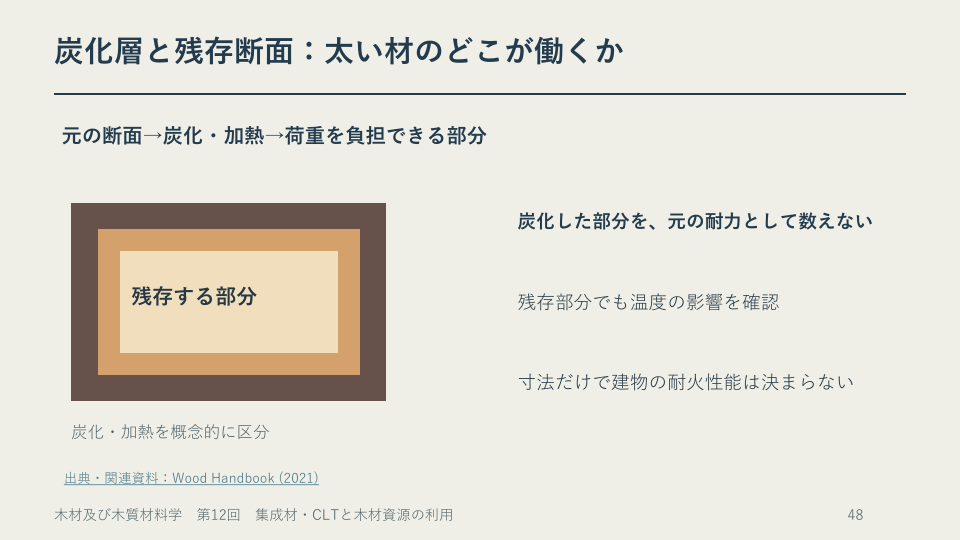

# 第12章　集成材・CLTと木材資源の利用

学習ガイド更新日：2026年11月6日。スライドは章・節版、時刻は節の見通し付き動画に対応します。ガイドのページ番号は本編 p. の番号です。PDFビューアーの通し枚数と異なる場合は、しおりまたは節の導入位置を目印にしてください。

## この章の各節

学習ガイドを開き、視聴する節の「扱う話題」と「結論の見通し」を先に読んでください。ページ番号と開始時刻を目印に、スライドや動画へ進みます。

### 12.1　集成材・CLTの構成

**視聴の目印**　本編 p.1～28 ／ PDFの導入は1枚目 ／ 動画 00:00から

**扱う話題**　長さと大断面、平行積層と直交積層、床・壁、接合。

**結論の見通し**　積層の向きと荷重の向きを対応させ、部材と接合部の両方で変形を考える。

### 12.2　大規模建築と火災時の性能

**視聴の目印**　本編 p.29～51 ／ PDFの導入は30枚目 ／ 動画 25:41から

**扱う話題**　大館樹海ドーム、Brock Commons、荷重経路、炭化。

**結論の見通し**　建物の性能は部材と構造の組合せで決まる。火災時は炭化後に働く断面や接合・被覆も考える。

**Key graphic（PDF 48ページ）**　加熱された木材断面を外側の炭化層と内側の残存部分に分けて示す模式図。

### 12.3　資源の収支と新素材

**視聴の目印**　本編 p.52～78 ／ PDFの導入は54枚目 ／ 動画 47:05から

**扱う話題**　森林蓄積、再生可能性、炭素の換算、WPC、循環利用。

**結論の見通し**　再生には時間と管理が必要で、材料を比較するときは機能、寿命、対象範囲をそろえる。

### 12.4　バイオマスと用途の選び方

**視聴の目印**　本編 p.79～99 ／ PDFの導入は82枚目 ／ 動画 69:02から

**扱う話題**　含水状態、熱・電気の利用、修理と再利用、統合演習。

**結論の見通し**　同じ木材でも用途で求める条件が変わる。使い続ける案と燃料にする案は、それぞれの条件を示して比較する。

## この回の進め方と時間の目安

動画の再生時間は **88:56** です。長い演習待ち時間はありません。下の自己確認は、指定の場面で一時停止して行います。準備と自己確認を含めて **約96～99分** を見込みます（1倍速での計画例。追加の一時停止・任意の深掘り・正式課題は別）。

1. **準備（約2分）** [この回の教材](README.md)でPDFと動画を開き、下の自己確認の問いを一度読んでおきます。
2. **前半（00:00～51:28）** 集成材・CLTの構成から、大断面部材や建築での使い方を読む。
3. **後半（51:28～88:56）** 森林資源の収支と製品の利用・再資源化を考える。分けて視聴する場合は、後半の開始時刻から再開できます。
4. **視聴中の自己確認（一時停止で約5～8分・提出不要）** PDF58頁（51:28）で一時停止します。解説の前に、収穫量を変えたときの翌年の資源量を考える。解説やガイドで確かめ、迷った点を一つ残します。

[動画の目次とPDFページ](動画の目次.md)で戻る箇所を確認できます。ほかの例題や参考資料は復習・深掘りにも使えます。受講範囲と提出物はTeamsの案内に従ってください。

各節の冒頭に、扱う話題と結論の見通しを示す画面があります。音声・字幕・目次はこの動画の時刻に対応します。

集成材・CLTと木材資源の利用。99ページ、説明動画88:56。集成材・CLTの製法と構成から、建物、資源利用へ進みます。

| PDFページ | 動画の開始 | 内容 |
|---|---|---|
| 1–16 | 00:00 | 導入・集成材の製法、配置、曲げ |
| 17–28 | 15:10 | CLTの製法、床・壁、せん断、接合 |
| 29–43 | 25:55 | 大空間・高層建築の写真と荷重経路、施工 |
| 44–51 | 39:03 | 燃焼・炭化・火災時の性能・薪炭材 |
| 52–66 | 47:17 | 再生可能性、蓄積の収支、炭素換算 |
| 67–78 | 57:36 | 新素材、循環利用、比較条件、WPC |
| 79–87 | 69:17 | バイオマスの電気・熱利用、含水状態、修理 |
| 88–95 | 78:09 | 統合・数値例の解説 |
| 96–99 | 86:59 | 整理・参照資料 |

## オンデマンド回の質問・意見交換と振り返り

- **自己確認と解説**　上の自己確認に取り組み、動画またはガイドの解説で確かめます。根拠や条件があいまいだった箇所を一つ残してください。
- **Teamsで質問・意見交換**　本科目専用チームの該当回の案内から、下の問いについて自分の考えと根拠を短く書く、または他の人の考えに理由や質問を添えて返信できます。個別の相談はTeamsで担当教員へ連絡してください。
- **この回の意見交換の問い**　床や大きな梁に集成材・CLTを使うとき、積層の向きと荷重の向きをどう対応させますか。用途を一つ選び、接合部で確かめたいことも挙げましょう。
- **教員からの指導**　担当教員は、各回の受講期間終了後速やかに、質問への回答や、考え方・誤解しやすい点の補足をTeamsで行います。補足と回答は該当回の案内から確認してください。
- **進み具合の確認**　教員は毎週の受講確認票に加え、該当回の質問・意見交換で見えた理解やつまずきを確認し、必要な補足に使います。受講確認票は毎週木曜13時までに提出します。

意見交換は、A1～A4とは別の学習活動です。 [受講方法](../受講方法.md) ／ [受講確認票](../受講確認/README.md)

## 写真・図の見方

大館樹海ドーム、Brock Commons、Saraの写真と構造図を対応させ、集成材・CLT・コンクリート・鋼材の役割を確認します。建物全体の寸法を一本の部材長と取り違えないでください。1934年のFPL建築の写真は利用の歴史を示す例で、現在の性能基準を示す資料ではありません。WPCの屋外写真は評価用の暴露試験です。

積層・せん断・接合・炭化・炭素換算の図は本講義の模式図であり、寸法・変形量・温度分布の実測値ではありません。[追加図版と参照資料](図版と参照資料.md)も確認してください。

## PDFで受講する人のための出典リンク

以下のページ番号は本文 p. の番号です。PDFの該当箇所と、下のリンクのどちらからも原資料を開けます。

### p.97　材料・建築・燃焼

- [USDA Wood Handbook 第11章（木質複合材料）](https://research.fs.usda.gov/treesearch/62258)
- [USDA Wood Handbook 第18章（木造の火災安全）](https://research.fs.usda.gov/treesearch/62268)
- [大館樹海ドーム（日本建築家協会）](https://www.jia.or.jp/twentyfive_years/6078/)
- [Brock Commons（UBC）](https://livinglabs.ubc.ca/projects/brock-commons-tallwood-house)

### p.98　森林・文化・炭素

- [持続可能な社会と森林（林野庁）](https://www.rinya.maff.go.jp/j/sin_riyou/sustainability.html)
- [木の文化を支える森（林野庁）](https://www.rinya.maff.go.jp/j/kokuyu_rinya/kokumin_mori/katuyo/kinobunka_kojimori/kibunka.html)
- [建築物の炭素貯蔵量の表示（林野庁）](https://www.rinya.maff.go.jp/j/mokusan/mieruka.html)
- [IPCC AR6 WGIII 第7章（木材製品は7.4.5.3）](https://www.cambridge.org/core/books/climate-change-2022-mitigation-of-climate-change/agriculture-forestry-and-other-land-uses-afolu/465B45B2DF3F9DF46468F1445DBBE985)

### p.99　学校・認証・接合

- [中学校学習指導要領解説 技術・家庭編（2017、印刷p.28）](https://www.mext.go.jp/component/a_menu/education/micro_detail/__icsFiles/afieldfile/2019/03/18/1387018_009.pdf)
- [FSCの規格](https://fsc.org/en/standards)
- [USDA Wood Handbook 第8章（接合）](https://research.fs.usda.gov/treesearch/62253)

## 計算を確かめる

- 58–59ページ：期首1000、成長50、枯死10 m³。収穫40なら期末1000、収穫60なら980 m³。量の維持だけで持続可能性全体を判断しません。
- 63–64ページ：全質量600 kg、MCw 20％、炭素割合0.50。全乾500 kg、水100 kg、炭素250 kg-C、約917 kg-CO₂換算。年間吸収量や排出削減量ではありません。
- 92ページ：幅100、高さ200 mmならI≒6.67×10⁷ mm⁴。幅だけ2倍ならIは2倍、高さだけ2倍なら8倍。強度の倍率ではありません。
- 93ページ：直列のばねに10 kN。10 kN/mmと5 kN/mmなら変形1＋2＝3 mm。建物の設計値ではありません。
- 95ページ：燃料の熱量を100と置く仮想比較。発電25％で電力25、熱利用80％で熱80。ただし電気と熱は別の機能で、回収した熱を実際に使えるかも確認します。

動画中の演習は一時停止できます。授業内の自己確認は追加の提出課題ではありません。正式課題A4は第13回の材料選択と授業づくりの後に取り組み、配信・提出・締切はTeamsで確認してください。

[番外編「紙・パルプ・和紙」](../番外編/紙・パルプ・和紙.md)
