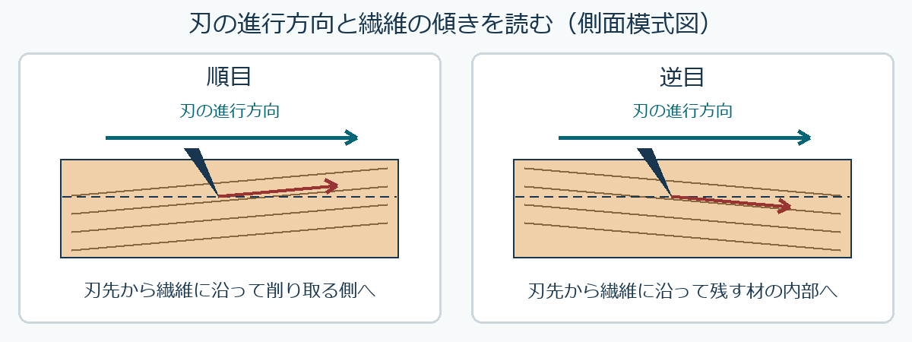

# 第13章　加工・材料選択と技術科への統合

学習ガイド更新日：2026年11月6日。スライドは章・節版、時刻は節の見通し付き動画に対応します。ガイドのページ番号は本編 p. の番号です。PDFビューアーの通し枚数と異なる場合は、しおりまたは節の導入位置を目印にしてください。

## この章の各節

学習ガイドを開き、視聴する節の「扱う話題」と「結論の見通し」を先に読んでください。ページ番号と開始時刻を目印に、スライドや動画へ進みます。

### 13.1　要求条件から棚を設計する

**視聴の目印**　本編 p.1～27 ／ PDFの導入は1枚目 ／ 動画 00:00から

**扱う話題**　荷重、許容たわみ、質量、EとI、支持間隔。

**結論の見通し**　材種を変えるほか、支え方や板の向きでも条件を満たせるかを、計算で比べる。

### 13.2　図面から加工と修理へ

**視聴の目印**　本編 p.28～41 ／ PDFの導入は29枚目 ／ 動画 29:19から

**扱う話題**　木目、けがき、木取り、接合と交換。

**結論の見通し**　図面の向きと実材の繊維方向を対応させ、力を伝え、加工・修理しやすい構成を選ぶ。

### 13.3　技術科の授業と評価を組み立てる

**視聴の目印**　本編 p.42～58 ／ PDFの導入は44枚目 ／ 動画 44:07から

**扱う話題**　中学生の観察、50分の授業案、記録と評価。

**結論の見通し**　観察・比較で生徒が確かめられる問いを設定し、その問いに対応する説明や記録で評価する。

### 13.4　CAD・ICTを活用する条件

**視聴の目印**　本編 p.59～82 ／ PDFの導入は62枚目 ／ 動画 63:14から

**扱う話題**　現行の解説と検討案、けがき、印刷倍率、工具径、課題A4。

**結論の見通し**　学校での導入は設備や安全管理に応じて検討する。CADの図は寸法や加工条件を実材で確かめて使う。

## この回の進め方と時間の目安

動画の再生時間は **89:40** です。長い演習待ち時間はありません。下の自己確認は、指定の場面で一時停止して行います。準備と自己確認を含めて **約97～100分** を見込みます（1倍速での計画例。追加の一時停止・任意の深掘り・正式課題は別）。

1. **準備（約2分）** [この回の教材](README.md)でPDFと動画を開き、下の自己確認の問いを一度読んでおきます。
2. **前半（00:00～40:36）** たわみ・質量・使用条件から材料候補を比較する。
3. **後半（40:36～89:40）** 選んだ材料を根拠とともに説明し、技術科の授業に組み立てる。分けて視聴する場合は、後半の開始時刻から再開できます。
4. **視聴中の自己確認（一時停止で約5～8分・提出不要）** PDF39頁（40:36）で一時停止します。小物棚の採用案を一つ選び、比較条件と追加で確かめる点を書く。解説やガイドで確かめ、迷った点を一つ残します。

[動画の目次とPDFページ](動画の目次.md)で戻る箇所を確認できます。ほかの例題や参考資料は復習・深掘りにも使えます。受講範囲と提出物はTeamsの案内に従ってください。

**正式課題 A4（別に100～130分が目安）** この回を終えたあと、[課題の案内](../課題/README.md)を開き、配信・締切をTeamsで確認します。

各節の冒頭に、扱う話題と結論の見通しを示す画面があります。音声・字幕・目次はこの動画の時刻に対応します。

2026年11月4日増補版。82ページ、説明動画89:40。従来の25ページ・20分04秒版を置き換えました。講義内の50分は中学校の授業案の時間であり、この動画中に50分の実習をするという意味ではありません。

| PDFページ | 動画の開始 | 内容 |
|---|---|---|
| 1–6 | 00:00 | 到達点・割合と単位・要求条件 |
| 7–20 | 06:40 | EとI、剛性・たわみ・質量を一行ずつ計算 |
| 21–27 | 20:54 | 支持間隔・板の向き・実寸法・逆算の比較 |
| 28–41 | 29:32 | 木目・けがき・木取り・接合・修理・採用理由 |
| 42–58 | 44:20 | 学習目標・50分の授業・評価と生徒の説明 |
| 59–65 | 63:29 | 現行の解説と検討案、CADから実物への手順 |
| 66–73 | 71:34 | ICTで予測・測定・記録、印刷倍率と工具径 |
| 74–79 | 81:48 | A4との関係・考察・歴史と文化の回への接続 |
| 80–82 | 87:45 | 参照資料 |

## オンデマンド回の質問・意見交換と振り返り

- **自己確認と解説**　上の自己確認に取り組み、動画またはガイドの解説で確かめます。根拠や条件があいまいだった箇所を一つ残してください。
- **Teamsで質問・意見交換**　本科目専用チームの該当回の案内から、下の問いについて自分の考えと根拠を短く書く、または他の人の考えに理由や質問を添えて返信できます。個別の相談はTeamsで担当教員へ連絡してください。
- **この回の意見交換の問い**　中学校で小物棚を製作するとしたら、材料を一つ選び、強度・加工性・入手性のうち何を優先しますか。条件が異なる人の案と比べましょう。
- **教員からの指導**　担当教員は、各回の受講期間終了後速やかに、質問への回答や、考え方・誤解しやすい点の補足をTeamsで行います。補足と回答は該当回の案内から確認してください。
- **進み具合の確認**　教員は毎週の受講確認票に加え、該当回の質問・意見交換で見えた理解やつまずきを確認し、必要な補足に使います。受講確認票は毎週木曜13時までに提出します。

意見交換は、A1～A4とは別の学習活動です。 [受講方法](../受講方法.md) ／ [受講確認票](../受講確認/README.md)

## 計算を確かめる

共通条件は幅80 mm、支持間隔600 mm、中央荷重100 Nの単純支持モデル。Aは高さ15 mm・E=10000 MPa・密度500 kg/m³、Bは18 mm・5000 MPa・700 kg/m³という仮想値です。質量計算に用いる部材全長も600 mmと置きます。

- 13–19ページ：IA=22500、IB=38880 mm⁴。EIはAが2.25×10⁸、Bが1.944×10⁸ N·mm²。たわみは約2.00、2.31 mm、質量は0.360、0.6048 kg。たわみ2.5 mm以下・質量0.50 kg以下ではAが候補ですが、強度・接合・使用環境は別途確認します。
- 23–27ページ：支点間距離600→450 mmならたわみは0.421875倍。同じ板80×15→15×80ならIは約28.44倍。断面積一定で高さ2倍・幅半分ならIは4倍です。条件の違う倍率を混同しません。仮にδ=2.20 mmならEの逆算値は約9091 MPaで、強度値ではありません。
- 48ページ：40×10と20×20 mmは同じ断面積400 mm²でもIは1：4です。同じE・L・Fのモデルなら、たわみの比は4：1です。
- 72–73ページ：100 mmの印刷線が97 mmなら倍率0.97、200 mmは194 mmになります。出力設定を直し実測で再確認します。直径4 mmの工具なら半径は2 mmですが、機械の操作手順や実際の補正値を指定する例ではありません。

[仮想データCSVと条件](データ/README.md)で図と数値を照合できます。講義の練習と正式課題A4の数値・条件を区別してください。

## 現行の解説と検討案

現行の平成29年告示の学習指導要領解説と、2026年8月4日の情報・技術WG取りまとめ（案）を分けて読みます。検討案は全国の学校で同じ設備・方法を実施すると確定したものではありません。CADでの設計、紙からのけがき・手加工、CAD/CAMによる機械加工を区別し、材料の向き・水分・接合を条件へ戻します。

[考察ワークシートと参照資料](ICTを活用した木材加工の考察.md)を使い、確認した事実・自分の提案・未確認事項を分けます。実技技能の達成は動画視聴だけでは判断できません。

## PDFで受講する人のための出典リンク

以下のページ番号は本文 p. の番号です。PDFの該当箇所と、下のリンクのどちらからも原資料を開けます。

### p.80　力学・接合・教育

- [USDA Wood Handbook 第5章（力学的性質）](https://research.fs.usda.gov/treesearch/62244)
- [USDA Wood Handbook 第8章（接合）](https://research.fs.usda.gov/treesearch/62253)
- [中学校学習指導要領解説 技術・家庭編（2017、印刷p.28）](https://www.mext.go.jp/component/a_menu/education/micro_detail/__icsFiles/afieldfile/2019/03/18/1387018_009.pdf)
- [文化財の保存技術（文化庁）](https://www.bunka.go.jp/seisaku/bunkazai/shokai/hozongijutsu/)

### p.59・81　検討資料

- [情報・技術WG取りまとめ（案、会議後修正）](https://www.mext.go.jp/content/20260804-mxt_kyoiku01-000051433-1.pdf)

### p.82　参照資料

- [USDA Wood Handbook 全体](https://research.fs.usda.gov/fpl/wood-handbook)
- [授業改善の資料（文部科学省）](https://www.mext.go.jp/a_menu/shotou/new-cs/senseiouen/mext_02685.html)

## 木目を読んで削る：順目と逆目

第13回の木取りと加工をつなぐ補足です。板の側面で繊維の傾きを見ます。図の破線は仕上げ面の予定位置、赤い矢印は刃先から繊維に沿う先割れの進み方です。順目では割れが削り取る側へ向かいやすく、逆目では材の内部へ進んで仕上げ面をむしり取ることがあります。

同じ板でも、節の周りなどでは繊維方向が変わります。材を作業台に確実に固定し、刃の進路から手を外します。授業では教員が端材で薄く試し削りし、両方向で仕上げ面を比べます。毛羽立ちやむしれが出た箇所は、加工方向や削り量を見直します。

**確認**　図の右側の材で、刃の進行方向を右から左へ変えると、先割れはどちら側へ向かいやすくなりますか。破線と繊維の傾きで説明してください。

**解答例**　図の繊維は右へ行くほど下がるので、左へ進むと刃先から繊維に沿う先割れは破線より上の削り取る側へ向かいやすくなります。節の周囲など繊維の向きが変わる箇所は、位置ごとに見ます。

[『木材科学講座6 切削加工』第2版 p.24、図1-11（海青社の書誌）](https://www.kaiseisha-press.ne.jp/ISBN9784860992286.html) ／ [順目・逆目の切削映像（京都大学OCW「木材加工学Ⅰ」）](https://ocw.kyoto-u.ac.jp/course/707/?video_id=6368)

## 自己確認と正式課題

13・17・22・39・46・58・77ページの問いでは、先に条件・式・単位・理由を書いてから解説を確認します。A4の設問・回答ID・配点は維持しています。正式な専用フォーム、配信・提出・期限はTeamsです。計算・資料読解・考察の時間は動画の再生時間とは別です。

次の第14・15回では、樹木・木材の進化史と人類史、日本の森林管理と木の文化を扱います。

[動画と教材](README.md)
